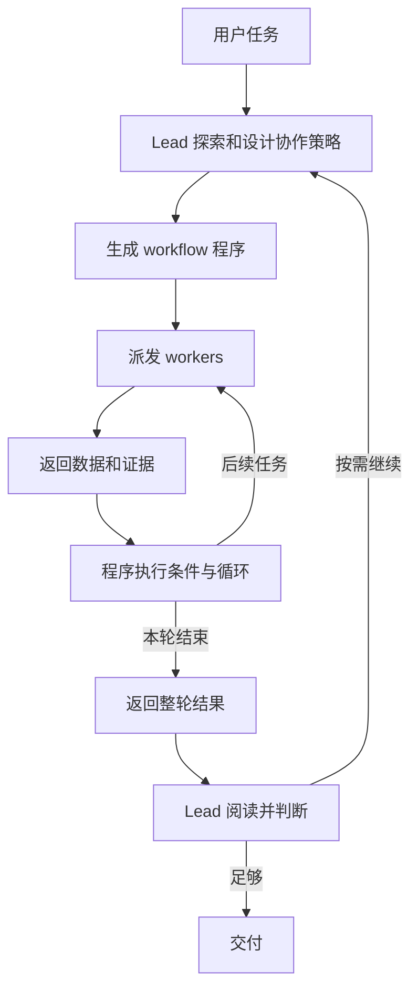

# Workflow 的行为模型

## 两个决策层

Lead 负责理解任务、探索范围、选择拆解粒度和验证策略，然后生成一份可执行的协作程序。Workflow 程序负责执行这份规则：启动 workers、等待返回、选择分支、组装后续 prompt、合并结果。

本地材料明确要求控制流由确定性程序表达。Lead 并不需要在每个 worker 返回后再次推理；需要模型判断的节点，应被安排成 agent 调用或放在下一轮 lead 工作中。

图中的循环是可表达的结构，不是每次都必然出现的固定阶段。

## 动态在哪里

| 提前生成的规则 | 执行时确定的数据 |
|---|---|
| 怎样拆分和筛选工作 | 实际文件、候选、文档、函数或问题清单 |
| 哪些结果需要验证 | 实际哪些候选触发验证 |
| 后续 prompt 如何构造 | 前序返回的描述、证据和产物路径 |
| 返工和循环条件 | 实际返工对象、轮数和 agent 数量 |
| 合并和停止标准 | 最终保留、否定、未验证及未覆盖项 |

例如，程序可以先让一个 agent 发现候选，然后为每个候选启动 prover。开始时并不知道候选有几个；程序通过遍历返回清单完成动态派发。若需要解释矛盾或重新拆解，可设计一个规划任务返回新的工作清单，但这不是运行器自动提供的通用 planner。

## 拆解方式

Lead 可以按文件/模块划分覆盖，也可以按正确性、安全、性能等不同视角重复观察同一对象。两种方式目的不同：前者扩展覆盖，后者增加独立判断。

官方指南推荐先在 lead 中进行小范围探索，发现工作清单，再启动编排；大任务可以分轮，让 lead 在每轮之间阅读结果。角色和任务 prompt 可临时产生，也可以受用户的预定义 agent 或任务模板约束。

实际自主实验中，lead 都选择了按领域分工的一轮并行审计。不能把指南中更复杂的模式误记成那两次实验已经出现的行为。

## Context 与 workspace

Worker 有自己的 conversation history。新 worker 的任务背景来自明确传入的 prompt、适用的项目指令和工具环境，而非默认复制 lead 的完整聊天历史。

本地 controlled probe 使用 lead-only nonce：三个 worker 的 incoming task 都没有它，返回值也都为空。源码还存在真实用户请求片段 relay 路径，因此这个实验不能证明所有用户文本永远不会传给 worker。

默认共同工作目录允许多个 workers 读取同一源码和前序产物。它不等于共享对话记忆。并行修改需要管理写入范围，或选择隔离工作树；隔离后也需要明确传递或合并产物。

## Handoff

典型 handoff 是 A 返回对象，程序取出需要的字段，写进 B 的任务；或者把 A 生成的文件路径传给 B。没有观察到本地脚本中的 peer mailbox 或 send_message 接口。

受控实验实际做到：A/B 并行读取 seed，A 写 artifact；两者结束后 C 的 prompt 带上它们的返回对象，C 再读 A 的文件。这证明了明确的数据和文件交接，但这份拓扑是实验预先指定的，不能证明 lead 自发设计了该链路。

## 阶段与依赖

本地 phase 主要用于展示进度；真正的依赖由 await 和程序结构建立。

Pipeline 中每个工作项可以独立进入下一步，快项无需等待所有慢项。只有合并、全局去重或需要跨项比较时，才必须收齐前序结果。程序不要求所有任务每个阶段都整齐同步。

## 审计与打回

返回格式校验保证数据形状，不保证结论真实。独立验证、反驳者、完整性检查者、测试和最终复核都需要明确安排。

“候选被证明”也不等于“最终汇总稿已独立审计”。Lead 的归纳仍可能遗漏或错述证据。实测中保留了这类错误和研究者修正，见 [修正记录](09-corrections-and-history.md)。

## 对意外问题的边界

新问题若能表示为既定候选、失败输入或返工标记，会走已写好的分支。若它挑战整体范围或策略，而计划没有通用出口，则没有证据表明运行器会自动重组 agents。通常先由 worker 返回发现，程序按现有规则处理，lead 在读取本轮结果后决定下一步；实际是否再开一轮仍受任务策略约束。

详细指令核对见 [重规划与结果交付](05-replanning-and-result-delivery.md)。

## 证据入口

- [官方本地指南](../evidence/prompts/workflow-authoring.txt)
- [受控 handoff](../evidence/live-probe/README.md)
- [自主 bug-hunt](../evidence/bug-hunt-probe/EXPERIMENT.md)
- [未知项目实验](../evidence/unknown-content-probe/EXPERIMENT.md)
- [云端公开行为说明](https://platform.claude.com/docs/en/managed-agents/workflow-runs#how-dynamic-workflows-work)
