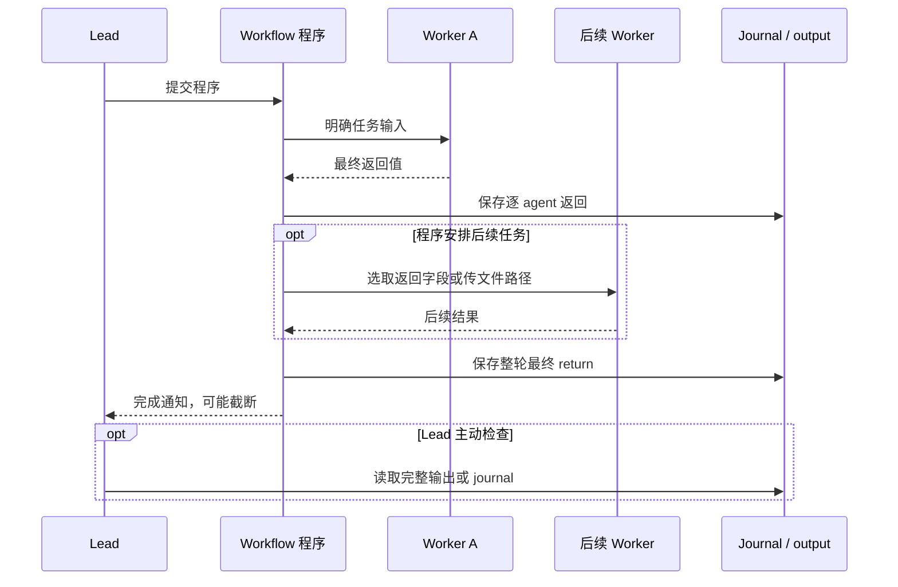

# 重规划、返工与 lead 接收结果的边界

本页回答调查中最后一个关键问题：官方指令是否要求通用重规划出口，以及 worker 的中间结果是否直接传给 lead。

## 指令核对的实际结论

检查范围包括本地 lead 的 recorded system chunks、Workflow 工具说明、完整 authoring 指南、两种 worker 指令、自定义 worker 后缀，以及四份目标类型模板。**没有找到要求每个 workflow 必须实现“任何预料外问题都触发重新拆解”的通用出口。**这是一项有范围的检索结论；云端完整私有 harness 未取得。

本地 [workflow-authoring](../evidence/prompts/workflow-authoring.txt) 有以下具体建议：

| 原文定位 | 指令的实际含义 | 不应扩大的含义 |
|---|---|---|
| 第 14 行 | 大型工作分轮，lead 阅读每轮结果，再决定下一阶段 | 每位 worker 返回都自动唤醒 lead |
| 第 114 行 | 按任务选择、组合质量模式 | 每种模式是强制执行器阶段 |
| 第 121 行 | 可循环发现，直到连续若干轮没有新项目 | 任何 workflow 默认持续探索 |
| 第 123 行 | Completeness critic 找遗漏，其输出形成下一轮工作 | 默认自动创建 critic 或 planner |
| 第 128 行 | 可设计新颖、自修复的 harness | 已存在通用自修复调度协议 |
| 第 130 行 | 控制流用确定性程序表达 | lead 在后台对每条返回即时重新规划 |
| 第 134 行附近 | 结果为空或意外时，先检查 journal | 检查 journal 等同运行中动态改写程序 |

Ultracode 指令加强编排与验证的倾向，也没有要求上述通用出口。Worker 结构化输出的纠错针对 schema；模型继续修正格式并不代表整体任务被重新拆解。

## 四份模板中的具体机制

### Bug hunter

[完整模板](../evidence/official-skill/bug-hunter.md) 要求 lead 选择 4–20 个大小相近、通常不超过约 1,500 行的切片，排除 tests、generated、vendor。特别小的任务由 lead 自己处理。

1. 每片 reader 逐行阅读、可运行小探针，返回 confidence 至少 2 的候选。
2. 每片都有第二次独立遗漏检查；第一轮没有发现或失败也不能免审。
3. 从两轮结果中选择 confidence 至少 3 的候选，最多 50 个。
4. 每候选一个 prover。传候选主张，避免传 finder 的推理；通过公开接口写失败测试，并在副本上修复验证。
5. 首次拒绝再交 fresh prover，附拒绝理由，尝试不同输入；第二次结论为最终结论。
6. 输出 confirmed、rejected、unverified 和 coverage，单 worker 失败不能使其他切片丢失。

模板限制最多 100 agents、30 分钟，与 engine 的累计 1,000 agents 上限是不同层次。它能吸收第二轮新发现和一次反证后的再验证，却没有要求遇到任意异常就改变切片策略。整轮失败或成果不足时报告已完成部分，并先询问用户再开另一个 run。

### Watchlist scanner

[完整模板](../evidence/official-skill/watchlist-scanner.md) 按 ticker 扫描，每 ticker 复核，按复核结果修正。**默认 Quick 模式**限制 scanner 最多三次搜索、reviewer 最多两次；reviewer 自己修正，代替额外 redo。Deep 模式才扩大检索与返工。

失败 ticker 记为未覆盖，不能伪装成 neutral。整轮失败或结果不足时先交付完成部分，另开 run 要询问。不能从模板概括为“所有模式默认都会追加第三位 agent”。

### Performance tuner

[完整模板](../evidence/official-skill/performance-tuner.md) 先优化、再独立 checker、按检查和排名决定 redo，最后独立测量。Checker 不接收 optimizer 声称的速度和理由，以降低锚定。

Checker 失败、发现更好算法或速度处于较差分组会触发 redo；optimizer 技术失败也进入 redo。未能检查的函数由 lead 随后自行检查。最终测量失败回退到最近有效版本或原版；lead 合并后自己运行测试。

这是围绕明确函数优化任务的反馈规则。整轮失败、超时或成果不足时保留磁盘上已通过检查的产物，再询问是否另开 run。

### Explainer video maker

[完整模板](../evidence/official-skill/explainer-video-maker.md) 先由 lead 生成 storyboard 和统一风格，再并行场景与音乐任务。独立 reviewer 最多指出一个需修复场景，只给这一场景追加一个 fixer。

音乐失败则交付无声版，报告未修复项。整体失败或结果不足时使用已完成部分，先询问再开另一 run。有限返工与降级是明确策略，不是无限循环。

## 发现“计划没有考虑的问题”时

| 情况 | 已证实会发生什么 | 需要另行设计或确认什么 |
|---|---|---|
| 返回新增候选，计划已经遍历候选验证 | 程序可为该候选继续派发 | 是否正确提取并保留候选 |
| Reviewer 返回失败标记，计划有 redo 分支 | 执行既定返工与停止规则 | 返工是否真的改善事实质量 |
| Worker 工具错误或 schema 不符 | 可按当前错误处理/格式纠错继续，或终止 | 错误处理是否覆盖本次异常 |
| 问题挑战最初范围、角色或假设 | 返回给程序；随后取决于已写规则和 lead 读到的内容 | 无通用重新拆解默认行为的证据 |
| 希望运行中重新拆解 | 可以安排规划 agent 返回新 worklist，再由程序派发 | 本次两次自主实验没有出现这种链路 |
| 希望 lead 改写并继续 | 本地有编辑、恢复入口；完成后也可再生成一轮 | 编辑后完整 CLI 恢复未实测，模板还可能要求先问用户 |

“可以编写”只表示程序表达能力；“官方推荐”是提示词建议；“默认发生”必须有可达源码或运行记录支持。三者在本调查中严格分开。

## 中间结果的默认路径

本地 worker 专用 system 明确说脚本读取最终文本或 StructuredOutput，不能用 SendUserMessage 交付。返回值先给程序；完整 return 写入 journal。程序可筛选、丢弃、汇总，运行器不会在最终通知中自动补回全部 worker 原文。

本地 [runtime](../evidence/formatted-js/workflow-runtime.js) 的 2045、3624、3880、4050、4070 行，结合 [hXn 通知生成器](../evidence/formatted-js/205220505.js) 的 264–424 行，显示三个不同通道：

- Worker 返回交给程序，并写 journal。
- 运行进度进入 task registry、UI 和 SDK 展示。
- 整轮结束，脚本最终值进入 lead 的 task-notification 队列。

第二条不能当作完整中间回答自动进入 lead 对话。Lead 可以主动读取日志；记录没有证明它默认订阅每个 worker 的所有消息。

## 未知项目的实际传递

[observations](../evidence/unknown-content-probe/export/observations.json)、[queue operations](../evidence/unknown-content-probe/export/lead/queue-operations.json)、[完整 tool IO](../evidence/unknown-content-probe/export/lead/tool-io.json) 可以交叉复核：

1. 三个 worker 完成后入队一条整轮完成通知。
2. 程序最终 return 包含三个 worker 的所有结果，紧凑 JSON 约 19,821 字符。
3. 通知带截断前缀和完整文件路径。本版本源码上限约 8,000 字符；XML 解码前缀为 7,976 字符，省略标记报告 11,914 字符。编码、转义和包装口径不同，不要求数字简单相加。
4. Lead 主动读取完整 output 文件；一次不正确的子串解析失败后，直接读取并解析完整 JSON 成功。
5. Lead 复现 CLI worker 的问题，之后继续做本地验证，没有再派 worker。

Lead 在等待期间也做过自己的检查；这些检查发生在收到完整结果之前，不应解释为它已读到了 worker 中间消息。

## 云端公开契约与尚未恢复部分

公开文档支持“worker 结果给程序、程序选后续工作；整轮结束后 lead 获得读取机会”的行为描述。预算和中断可以延迟或阻止这一轮；各 thread 消息留在各自事件流。客户端看到状态事件不代表 lead 获得消息正文。[Workflow runs](https://platform.claude.com/docs/en/managed-agents/workflow-runs#how-dynamic-workflows-work)

普通 subagent 的 follow-up 与 workflow worker 生命周期不同，不能将前者的可持续会话通道套给后者。[Multiagent orchestration](https://platform.claude.com/docs/en/managed-agents/multiagent-orchestration#hand-work-to-other-agents)

云端私有 lead 的全部运行中检查工具、隐藏重规划指令、私有结果注入格式和截断规则仍是未验证项。这里没有云端运行通信实证。
