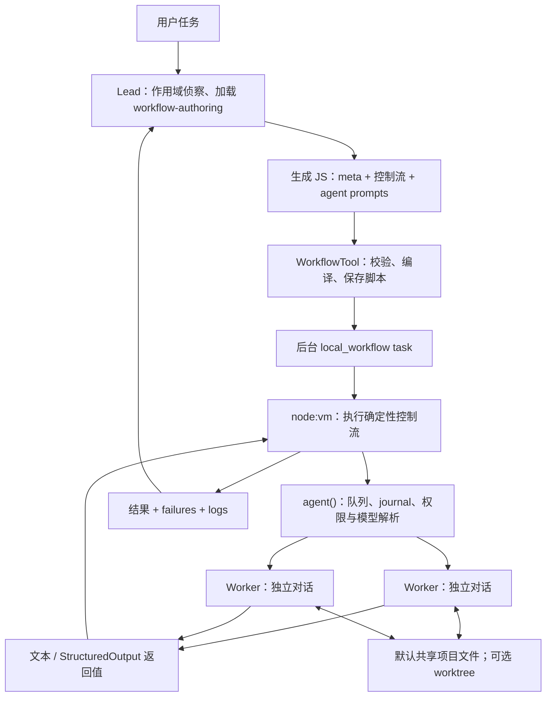

# Claude dynamic workflows：逆向结果与证据

调查日期：2026-10-11。目标是定位 `multiagent_20261001` 的编排、提示词和 agent 通信协议。

**已经恢复 Claude Code 2.1.296 的本地 Workflow 实现、完整 authoring 指南、worker 专用指令、内置 deep-research 脚本，以及使用 `multiagent_20261001` 的四份官方云端模板；已实跑一个三 worker 的本地 Workflow，导出 lead/worker 的 recorded system chunks、工具定义、任务消息与生成脚本。没有取得 Managed Agents 服务端私有执行器、隐藏工具 schema 或完整 harness system prompt。**

这两个产品层面需要分开。`multiagent_20261001` 是 **Claude Managed Agents API 的配置类型**；Claude Code 本地同样提供 dynamic workflows，但本次没有发现本地 Workflow 入口消费这个标识。本地源码可以解释一种实际发布的编排实现；包内 Managed Agents 模板和官方 SDK 可以直接解释目标类型的配置与公开契约；两者的运行时一致性尚无证据。[官方 multiagent 文档](https://platform.claude.com/docs/en/managed-agents/multiagent-orchestration)、[Claude Code workflows](https://code.claude.com/docs/en/workflows)

### 本地配置、编排和工具执行的区别（后续核对补充）

`Turn on dynamic workflows` 的 CLI 示例是 `ant apply contract-reviewer.md`。文件在本地，但 ant apply 创建 / 更新的是 Claude API resources，写入 lockfile 的是远程 agent ID。因此该示例本身不能证明编排器在本机执行。[ant apply 官方定义](https://platform.claude.com/docs/en/cli-sdks-libraries/cli/apply)

| 场景 | 配置与执行位置 |
|---|---|
| Claude Code 本地 dynamic workflows | 使用本地 Workflow tool、JS runtime 和 Claude Code 设置；本报告已追踪源码 |
| Managed Agents，通过 ant CLI 配置 | 本地维护 Markdown / YAML，资源同步到 API；multiagent_20261001 在该配置中 |
| Managed Agents，self_hosted sandbox | 工具、文件与进程在自有基础设施，编排仍在 Anthropic 服务端 |

第三种是官方明确支持的部署方式，所以笼统说“multiagent_20261001 只能云端执行”不准确。准确边界是 API 配置与服务端编排，不是工具一定在 Anthropic 的 cloud sandbox 执行。[Self-hosted sandboxes](https://platform.claude.com/docs/en/managed-agents/self-hosted-sandboxes)

先读 [全部提示词原文索引](PROMPTS.md)，尤其是 [云端 Bug hunter 完整模板](prompts/cloud-template-bug-hunter-t77r14b6.md)、[本地 workflow-authoring](prompts/workflow-authoring.txt) 和 [内置 deep-research 完整脚本](builtins/deep-research-0.js)。

## 证据范围

| 材料 | 状态与来源 |
|---|---|
| 机器上已有 Claude Code | 2.1.123，原路径与版本保持不变；未发现目标标识 |
| 本次主要分析对象 | 官方 npm `@anthropic-ai/claude-code-darwin-arm64@2.1.296`；独立下载副本，静态分析并实跑一个受限三 worker 本地 Workflow |
| 云端 API 契约 | 官方 `@anthropic-ai/sdk@0.133.0` 的 agents、sessions、threads 源码 |
| REA | 实际使用安装的 rea-agents 6.3.0，分析提取的 JavaScript；原生 Ghidra/Hopper/IDA provider 未配置 |
| 动态验证 | 五项原函数探针；一次真实本地 LLM Workflow；云端 create-agent 因余额不足被拒绝 |
| 未做事项 | 认证由 claude/ant CLI 处理，未读取认证存储；未启动 Managed Agents run，未更新已安装 Claude，未修改 Synergy 仓库 |

主二进制为 arm64 Mach-O，240,664,432 bytes，SHA-256：

```text
c9b5341637becbd423ddffc5b254afb645682a3868cb708bbc6cc0e7bb419937
```

[官方 npm 分发包](https://registry.npmjs.org/@anthropic-ai/claude-code-darwin-arm64/-/claude-code-darwin-arm64-2.1.296.tgz) 与 [本地 metadata](native-latest-metadata.json) 对应。两个 Claude tarball 和 SDK tarball 均核对了 registry metadata 中的 SHA-512 SRI；这不是 registry 签名验证。

### 为什么直接恢复 JS 比反汇编有效

Mach-O 的 `__BUN/__bun` 段包含 Bun standalone module graph。它携带 bytecode，也保留完整的压缩排版 JS 源码。依据尾部 `\n---- Bun! ----\n`、32-byte Offsets 和 52-byte 文件记录解析，而非把一次 strings 搜索当成完整提取。

结果：2,609 个嵌入文件，总 contents 52,986,680 bytes；其中 2,365 个标记 `// @bun @bytecode` 的 JS 源码段，共 45,036,083 bytes；没有 source map。入口是 `/$bunfs/root/cli`。后续按 zstd magic 解压了 141 个资源，共 10,264,450 bytes，补齐了先前直接文本检索跳过的内容，并找到第四份 multiagent 模板 Performance tuner。来源与哈希见 [解压 manifest](decoded-assets-manifest.json)、[解压器](decode-assets.py)。

可复核材料：[提取器](extract-bun.py)、[提取摘要](bun-extraction.json)、[每文件位置与摘要](bun-files-manifest.json)。格式依据 [Bun 的 StandaloneModuleGraph 实现](https://raw.githubusercontent.com/oven-sh/bun/main/src/standalone_graph/StandaloneModuleGraph.rs)。

REA 对 slice 中 13 个 JS 文件的语法解析没有失败；语义图达到 100,000 节点限制，仍有 33,612 个 unknown。缩小到 3 文件 kernel 后没有图截断，解析 23,949 个 AST 节点，但还有 5,078 个 semantic unknown。**REA 的完整文件 inventory 不代表完整语义恢复。** 下面的重要结论另有人工调用链追踪和原函数探针支持。[REA 摘要](rea-summaries.json)，[完整 Evidence 压缩包](rea-evidence.json.gz)，[REA 项目](https://github.com/morluto/rea)

## 目标类型：云端 multiagent_20261001

官方 SDK 明确包含该 discriminator，默认同时启用 workflows 和 subagents，advisor 默认关闭。workflow inline agents 默认允许；预定义 agents 列表与普通 subagents 的列表分开配置。预定义引用会固定版本，inline agent 则由 lead / workflow 临时定义。

来源：[agents.ts](cloud-sdk/package/src/resources/beta/agents/agents.ts)，尤其 `BetaManagedAgentsMultiagent20261001Params`、`BetaManagedAgentsMultiagentWorkflowsEnabledParams`、`BetaManagedAgentsMultiagentSubagentsEnabledParams`。

```json
{
  "multiagent": {
    "type": "multiagent_20261001",
    "workflows": { "type": "enabled" },
    "subagents": { "type": "disabled" }
  }
}
```

这是包内 Bug hunter 模板的配置选择：集中通过 workflow 编排，禁用 lead 直接派发普通 subagent。它不是该类型唯一允许的配置。

云端是 lead 写程序、服务端后台执行。每个 worker 有独立 conversation history，在同一个 session sandbox 工作；结果由程序传递。普通 subagent 支持 lead 追问，而 workflow worker 没有这种跟进通道。[官方编排说明](https://platform.claude.com/docs/en/managed-agents/multiagent-orchestration)、[session threads](https://platform.claude.com/docs/en/managed-agents/session-threads)

### 直接恢复的云端完整任务提示词

[Bug hunter](prompts/cloud-template-bug-hunter-t77r14b6.md) 是官方分发包携带的 Console agent 模板，`agent.md` 内含完整自定义 system prompt、工具配置和任务规则。还有 [Watchlist scanner](prompts/cloud-template-watchlist-scanner-kfkrzjrr.md) 与 [Explainer video maker](prompts/cloud-template-explainer-video-maker-sm29032a.md) 两份模板使用同一类型；后续 zstd 解压恢复 [Performance tuner](prompts/cloud-template-performance-tuner-6c866b59.md)，因此共有四份。另附 [Deep researcher](prompts/cloud-template-deep-researcher-kr59y5yh.md)，但这份模板没有该 multiagent 标识。

Bug hunter 的具体策略如下；它是模板策略，不是所有 workflows 固定经过的阶段。

| 环节 | 可恢复的精确规则 |
|---|---|
| 取代码与划分 | 记录 commit / version；从文件名和行数划分 4–20 个大致等量 slice，目标每个不明显超过 1,500 行，大文件独立；文件只归属一个 slice；跳过 tests、vendor、generated |
| Read the code | 每 slice 一位 reader，全量逐行阅读并报告覆盖行数；检查边界、循环、默认值、解析、状态与错误路径；先做小实验；返回所有置信分 ≥2 的怀疑，无候选数量上限 |
| Second look at every slice | 每 slice 再派一位 reviewer，即使 reader 未发现问题或失败；拿到第一轮的简短 claim 清单，逐行再读，专找遗漏、默认值、返回值、条件、参数与常量错误 |
| Pick the candidates | 不调用 agent；保留置信分 ≥3 的候选，最多 50 个，优先最有把握的 |
| Prove each candidate | 每候选一位 prover，给 claim，**不给发现者的推理**；从 public interface 写最小失败测试；在副本验证最小修复；区分 demonstrated、confirmed by reading、rejected |
| 驳回后的复查 | 第一次被拒绝的 claim 再给一位新 prover，提供驳回理由，要求尝试不同输入；第二次结论为最终结论 |
| 汇总 | 写 bug-report.md：位置、输入、预期/实际、失败测试、修复、严重程度；同时说明覆盖、被拒绝及未验证候选 |

模板给 lead 的运行计划目标是至多 100 agents，超出先询问用户；单次 run 设 30 分钟；每 phase 在顶层开启一次。这个“100”是任务提示词要求，并非云端 engine 的硬上限。第一轮、第二轮、prover 重试的数量仍需要程序统筹。

模板直接暴露以下云端 API 名称及要求：

- 每个 `step.agent` 调用用 `define` 定义 inline agent，至少提供 name 和 system prompt。
- 没有 named agents 时，不能用预定义 `agent` 引用。
- `define` 中省略 model，继承 lead 模型；省略 tools，由 engine 下发 lead 的工具。
- 程序不使用当前时钟或随机数，用 slice / candidate 序号命名 worker。
- worker 在各自的临时子目录写实验文件，不互读；失败不使全 run 自动失败。

Watchlist scanner 还直接使用 `step.now()` 取得 UTC 时间。它与本地禁用 `Date.now()` 的 surface 不同；是否采用 journal 来记录时钟结果，未取得源码证明。

**没有恢复 `step.agent` / `define` 的完整函数签名、隐藏工具描述和服务端程序校验器，因此没有把本地 `agent(prompt, opts)` 语法伪装成云端 DSL。** 搜索补齐压缩资源后，调用这些 DSL 名称的是四份模板；Managed Agents 标识也在 onboarding/API 指南中出现，没有发现本地 JS Workflow 入口消费它。

模板附带的 session.yaml 写 `amount: "500"`。按 API 契约，这是整数美分，即 **USD 5.00**，不是 USD 500；先前记录已修正。本次本地探针单独使用 CLI 的 1.50 美元上限，报告累计模型 list-cost 0.1408173；未启动云端 session。模板的目标仓库示例是 QuixBugs，不能据此认定它就是你提到的 116k 行、70 个植入 bug 的 benchmark。

### 云端限制和外部可见的协议

按本次检索时官方文档：单 run 同时工作的线程为 64，生命周期内启动 agent 上限为 1,000，默认 lifetime 为 24 小时，每 session 默认最多 10 个开放 run。失败重试可以使用新线程，所以 thread 总数可能高于 1,000；64 不被 API 保证为永久不变的常量。run 不能嵌套。[官方 run 限制](https://platform.claude.com/docs/en/managed-agents/workflow-runs#budgets-and-limits)

官方 SDK 暴露：

| 对象 / event | 关键字段 |
|---|---|
| `workflow_run.created` | run id、name、description、phase id/name/description |
| `workflow_run.phase_started` / `phase_ended` | run id、phase id，结束事件引用对应开始事件 |
| `status_running` / `status_idle` / `status_ended` | 后台执行状态及结束原因 |
| `session.thread_created` | worker thread id、workflow_run_id |
| thread.agent，inline 情况 | name、description、model、tools、skills、mcp_servers、**system** |
| thread.usage | 累计 token usage；可以按 workflow_run_id 聚合 |

来源：[sessions/events.ts](cloud-sdk/package/src/resources/beta/sessions/events.ts)、[threads.ts](cloud-sdk/package/src/resources/beta/sessions/threads/threads.ts)。

`completed` 表示程序完成，不保证每个 worker 成功或任务结论正确。仅 session idle 也不足以判定任务结束；须结合所有 run 已结束和 lead 的 end_turn。

外部接口不展示生成程序、启动/管理 run 的隐藏工具调用、或 worker 交给程序的那个返回对象。inline agent 的 `system` 可以读取，但这是程序定义的 prompt，不能等同整个服务端 system stack。官方提供程序回读办法：run 结束且 session idle 后，让 lead 原样展示刚执行的程序，明确要求不启动新 run。[官方可见性与回读说明](https://platform.claude.com/docs/en/managed-agents/workflow-runs#a-runs-threads)

## 四份模板究竟在哪里使用

三份未压缩资源与新增的压缩模板最终进入 **claude-api 的 Skill 文件表**，调用链为：

```text
CLI / session 初始化 -> XEe() 初始化 bundled skills
  -> chunk-yvwrs8a8.js: registerClaudeApiSkill (重新导出 $Bs)
  -> chunk-k9bc38yt.js: $Bs 注册 claude-api
      files() -> k() 动态导入 chunk-p6hmrjkc.js -> A() 解码/变量替换
      getPromptForCommand() -> L() 列 quickstarts -> b() 匹配命令
          -> U() 把匹配模板嵌入 <doc path=...>
  -> /claude-api managed-agents-onboard <quickstart-name>
      读取 onboarding-from-quickstart.md
      写 agent.md/environment.yaml/session.yaml -> ant apply 同步到 API
```

`chunk-p6hmrjkc.js` 的资源映射精确为：

| 模板 | 资源加载与文件表位置 |
|---|---|
| Bug hunter | Mt = Le(bug-hunter-t77r14b6.md)，映射 shared/managed-agents-quickstarts/bug-hunter.md |
| Explainer video maker | Jt = Le(explainer-video-maker-sm29032a.md)，映射同名 quickstart |
| Watchlist scanner | Gt = Le(watchlist-scanner-kfkrzjrr.md)，映射同名 quickstart |
| Performance tuner | Qt = Je(performance-tuner-6c866b59.md.zst)，Je 解压 zstd，映射同名 quickstart |

`A()/p()` 去除 HTML comments，并把 `{{OPUS_ID}}` 换成 SKILL_MODEL_VARS 的 claude-opus-5-5。这四份模板与 Anthropic 公开仓库的固定 commit 在该变量替换后**逐字一致**：[对比记录](official-skill/comparison.json)、[官方更新 commit](https://github.com/anthropics/skills/commit/dbd4588f9e1033efb41dad4bef2f7947c8993d44)。模板不是从云端私有 prompt 泄露恢复的内容，而是正式分发的 onboarding 配置。

可复核位置：[文件表](formatted-js/chunk-p6hmrjkc.js)、[Skill 注册/选模板逻辑](formatted-js/chunk-k9bc38yt.js)、[初始化片段与来源 hash](template-call-sites.json)。包内 [Managed Agents 指南](decoded-assets/managed-agents-multiagent-145d83bb.md) 第 145 行明确区分 Managed Agents dynamic workflows 和 Claude Code 的 Workflow tool。

所以能确认的是**模板入口与本地 Workflow 执行入口分开**。不能确认两个服务端是否复用了某个内部库；目前没有服务端源码证据。尤其不能因为模板与执行器同在 Claude Code 包里，就认为模板走本地 node:vm 的编排。

| 对照点 | Claude Code 本地可达实现 | Managed Agents 目标类型 |
|---|---|---|
| 程序接口 | agent/parallel/pipeline/phase/workflow 等 globals | 模板暴露 step.agent/define/step.now；完整签名尚缺 |
| 自定义 worker | opts.agentType 引用客户端 registry，schema 可加 StructuredOutput | define inline system；另可引用 predefined_agents |
| 模型 | 本地 opts.model/effort 可指定，受 force 设置影响 | inline 继承 session agent；别的模型通过预定义 agents 配置 |
| workspace | 默认项目 cwd；worktree 可选 | 同一个 session sandbox/挂载 memory store |
| 上下文 | 不 fork 完整 lead history；可能 relay 用户请求 | 独立 thread history，inline system 来自程序 |
| 并发 | 默认取本机 CPU，2–16 | 当前文档为 64，不保证常量 |
| 嵌套 | 本地子 workflow 最多一层 | workflow run 不嵌套 |
| 可观测 | 保存 script、journal、worker transcripts | run events + thread streams；API 不直接显示 program/隐藏工具/返回对象 |

云端栏是模板、SDK 与公开契约证据，不是本次 cloud run 实测。[云端行为文档](https://platform.claude.com/docs/en/managed-agents/workflow-runs)

## 真实本地运行：三 worker 如何派发与通信

[实测总记录](live-probe/README.md) 包含输入、生成脚本、journal、每角色完整 recorded prompt 与 tool schemas。执行过程：

```mermaid
sequenceDiagram
    participant Lead
    participant Program as Workflow 程序
    participant A as Worker A
    participant B as Worker B
    participant Files as 共享 cwd
    participant C as Worker C
    Lead->>Program: meta + JS + schemas + worker prompts
    par Observe
        Program->>A: 独立任务、schema
        A->>Files: Read seed; Write artifact
        A-->>Program: StructuredOutput 对象 A
    and
        Program->>B: 独立任务、schema
        B->>Files: Read seed
        B-->>Program: StructuredOutput 对象 B
    end
    Program->>C: 把 JSON.stringify(A/B) 明确写入 prompt
    C->>Files: Read artifact
    C-->>Program: StructuredOutput 对象 C
    Program-->>Lead: 运行结果、失败列表、日志
```

A/B 都读到 workspace-shared-6295；C 读到 A 写的 artifact-A-85192，并把收到的 A/B 对象原样返回。只在 lead 任务中的 nonce 没有出现在 worker incoming messages，三个 worker 都返回 leadOnlyValue=null。journal 的 started/result 顺序证明 A/B 同时在进行、C 等到两者完成后启动。没有 peer-message tool 调用；通信走返回值与文件。

这个结论不只来自让模型自述：worker Read/Write/StructuredOutput 的实际 tool calls、任务输入和 journal 均保留。独立 conversation 也有单独 transcript。本次 print/safe/restricted 环境中的 worker 没有 trusted-human request relay；源码允许其他模式 relay 用户请求片段，因此不能把 nonce 结果泛化为任何用户文本永不传递。

实测导出 **24 个文件、184,686 bytes**。Lead system 10 chunks；worker 各 4 chunks，工具定义各含 StructuredOutput 及其 schema。见 [lead](live-probe/prompts/lead-system.json)、[A](live-probe/prompts/worker-A-system.json)、[B](live-probe/prompts/worker-B-system.json)、[C](live-probe/prompts/worker-C-system.json)、[hash manifest](live-probe/prompt-manifest.json)。CLI 累计模型 list-cost **$0.1408173**，不是 Pro 订阅实际现金扣费证明；用量见 [summary](live-probe/summary.json)。普通 subagent_stats.spawned=0，但 Workflow 有三个 worker，两个统计入口不同。

## 已恢复的本地 Claude Code Workflow 实现

这一节是 2.1.296 已发布客户端的实现事实，不外推为云端私有实现。

### 执行链



调用链：

```text
WorkflowTool.call
  → YS(meta parser)
  → qie(script compiler)
  → ejt(background task)
  → lr
  → lXn(VM + API globals)
  → ir.agent
  → kr(worker configuration)
  → vC(subagent runner)
```

[workflow-tool.js](formatted-js/workflow-tool.js) 的工具定义在 2,645 行附近，脚本验证/编译和启动在 2,933–3,009 行；[workflow-runtime.js](formatted-js/workflow-runtime.js) 的 VM 在 3,520 行、后台任务在 3,783 行、worker runner 调用在 2,653 行。

输入包含 `script`、`name`、`scriptPath`、`args`、`resumeFromRunId`。`meta` 是纯字面量对象，含 name/description，可带 phases。脚本是 JS，不是 TS；body 包在 async 执行上下文。`scriptPath` 优先于其他脚本选择方式。

调用先返回 `async_launched` 和 taskId/runId/scriptPath/transcriptDir，之后后台 task 汇报最终结果。**该状态本身不是成功证据**：源码里编译失败也会产生带 error 的 `async_launched` 结果。

### 实际 API 和多 agent 通信

| API | 行为 |
|---|---|
| `agent(prompt, opts)` | 默认返回 worker 最后 assistant 文本，逐字字符串；带 JSON Schema 则返回验证过的对象 |
| `pipeline(items, ...stages)` | 每个 item 独立依次进入各 stage；不同 item 无 stage 间屏障；callback 参数是 previous、originalItem、index |
| `parallel(thunks)` | Promise.allSettled 屏障，等全部 thunk；输出按输入顺序；任务 throw 变 null |
| `phase(title)` | 标记进度分组，不创建依赖或阶段屏障 |
| `log(message)` | UI 进度行 |
| `args` | workflow 参数，跨 VM 边界复制 |
| `budget` | total/spent()/remaining()；本版本的实际注入限制见后文 |
| `workflow(nameOrRef, args)` | 在本 run 内执行一个子 workflow，最多一层，共享限流、计数、abort、预算 |

`parallel` 要数组中的元素是函数，传 Promise 数组会报错；输入校验和 cap 检查仍可能 throw，因此“不会 reject”只适用于已进入聚合的子任务失败。`pipeline` 某项 throw 或返回 null 后，后续 stages 被跳过，此项结果为 null。[runtime.js：parallel/pipeline](formatted-js/workflow-runtime.js)

这是 **程序调用 / 返回值协议**。workflow script 本身没有 peer mailbox 或 send_message API；它保存 A 的结果，再把需要的字段编入 B 的 prompt，或让 agent 读共享文件。共享文件会产生写冲突，只有选择 worktree 时才隔离 Git 文件。

worker 不自动复制 lead 的完整聊天记录。`vC` 此处只接收 relayed user request 和 computed task 的 promptMessages，没有传 forkContextMessages；runner 在未提供 fork 时从空 history 开始，同时单独载入项目 user/system context，包括适用的 CLAUDE.md。自定义 agent 可以选择省略项目指令。[worker 调用](formatted-js/workflow-runtime.js)、[subagent-runner.js](formatted-js/subagent-runner.js)

默认 workflow worker 的 disallowedTools 为 **SendUserMessage、Agent、Workflow**；自定义 agent 的 denies 与它们合并。这会把继续编排的责任留给脚本，并让 worker 把结果交回调用者，而非直接向用户发消息。

StructuredOutput 是运行时添加的工具，调用输入在工具层验证。worker 缺失或 schema 不符时有重试 / 提醒机制；默认结构化重试阈值为 5，可由 MAX_STRUCTURED_OUTPUT_RETRIES 覆盖。runner 消费 `structured_output` attachment.data，脚本得到对象，不需要 lead 再解析文本 JSON。它保证形状，不保证结论为真。

### 完整提示词的层次

本地 Workflow 工具描述是：

```text
O1r(hasSkillTool)
+ NQr(config.workflowSizeGuideline, accountDefault)
+ it() // 在该发布包中为 ""
```

有 Skill 时先引导加载 workflow-authoring；没有时完整内联 authoring 指南。已导出两个默认大小下的**组合工具提示词**：

- [有 Skill，small](prompts/workflow-tool-complete-with-skill-small.txt) / [medium](prompts/workflow-tool-complete-with-skill-medium.txt)
- [完整内联，small](prompts/workflow-tool-complete-inline-small.txt) / [medium](prompts/workflow-tool-complete-inline-medium.txt)
- [authoring 原文](prompts/workflow-authoring.txt) / [强制模型变体](prompts/workflow-authoring-model-forced.txt)

配置 size 是指导规模，small <5、medium <10、large <50；unrestricted 不附 size 文本。Pro 的默认是 small，其他默认 medium；这不是硬 cap。[flags 与 size 函数](formatted-js/chunk-c5zwk83v.js)

worker 的专用 system 指令原文已保存：[文本 worker](prompts/worker-text-system.txt)、[StructuredOutput worker](prompts/worker-structured-system.txt)、[自定义文本追加](prompts/custom-worker-text-suffix.txt)、[自定义结构化追加](prompts/custom-worker-structured-suffix.txt)。

普通 worker 专用指令仅 594 bytes，核心要求是：最后文本是脚本的逐字返回值、输出实际数据、不要 Done/Sent、不要 SendUserMessage。schema worker 要求最终用 StructuredOutput 返回，成功后结束，验证失败读错误再修正。

**这些静态专用指令不是每次模型请求的完整 system。** 通用 base system、环境、CLAUDE.md、tool schema、自定义 agent 与运行状态由 subagent runner 动态组合。本次已用 system-prompt-snapshot 导出一次实际运行的 system chunks、cliPrefix、工具定义与任务消息：[实测 prompt 记录](live-probe/README.md)。它补齐了这次 local harness 的记录；瞬时 attachment 渲染、HTTP headers/cache layout 未完整抓取，因此仍不标为“完整 wire prompt”，也不是 Managed Agents 私有 system。

此外恢复了四份 provenance framing：computed task、user request、assistant context、automated trigger。[原文索引](PROMPTS.md)、[实现](formatted-js/chunk-6f3cp7aa.js)

它们将 script 算出的任务标为无用户授权的内容，把真实用户请求独立传入，引用文本逐行缩进；自动触发不能自行宣称用户批准。功能受 env / flag 控制。这是权限和来源的 framing，不是 agent 之间的消息总线。

### 调度、隔离、恢复和成本

| 机制 | 2.1.296 本地实现 |
|---|---|
| 默认并发 | `min(16, max(2, availableCPUs - 2))`；多余请求排队；env 可覆盖 |
| 累计 agent cap | 1,000；调用计数在 cache 查询之前增加，所以缓存命中也计数 |
| 单次聚合参数数量 | parallel / pipeline 数组最多 4,096 项 |
| 默认文件系统 | 当前项目共享；opts.isolation="worktree" 可隔离改动 |
| remote isolation | 本包显式抛出 not available；源码里的 remote gate=50 不能当作已支持功能 |
| VM | node:vm，禁动态 string code generation / Wasm；不提供 Node / filesystem API |
| 同步执行保护 | 30,000ms；是 VM 同步执行限制，不是整个 async workflow lifetime |
| 确定性 | Date.now、无参 new Date、Math.random 被禁；显式日期可用 |
| journal | launched / started / result / failed 记录，保存 script 与各 worker transcript |
| 恢复 | 未改变的调用序列前缀读缓存；发生变化后余下部分重跑 |

journal key 实际为：

```text
"v2:" + SHA256(previousKey + "\0" + prompt + "\0" + stableOptions)
```

参与 stableOptions 的字段为 schema、model、effort、isolation、agentType、disallowedTools、bashCommandClamp；对象键排序，label / phase 不参与。只改展示标签不重跑；改模型或某次 prompt 会使该项和后续缓存失效。[Hr / No 实现](formatted-js/workflow-runtime.js)

缓存依据调用，不是代码仓库和外部世界的快照。文件变了但 prompt / opts 一样，不意味着缓存结论仍有效。并发程序若使后续 agent 调用顺序变化，也会影响链式 key。这是由源码可推导出的使用限制，并未实测完整 CLI resume。

**预算接线存在需要保留的差异：** authoring prompt 宣称用户的 "+500k" output-token target 会成为硬 ceiling；kernel 确有 finite-budget 检查，但本包可达的 ejt launch 路径在 3,840 行构造的是 `{ total: null, getTurnSpent: Fg }`，然后传给 lr。该路径下 remaining() 为 Infinity。不能只因文档字符串写了 hard ceiling，就宣称本地用户 "+500k" 指令已经接通；本次也没做实际 "+500k" 集成运行。

模型选择默认继承 resolved main-loop model，支持 opts.model/effort；强制 subagent model 会覆盖 caller 的 model。另有按 system 前缀、model、effort、agentType、tools、schema、cwd 分组的 cache warmer，首请求先暖 prompt cache，再释放同组队列。这解释减少冷缓存的工程设计。本次本地 list-cost 与 cache 用量另见 [实测结果](live-probe/summary.json)，并非订阅实际扣款证明。

### 一个重要的死代码排除

workflow-tool.js 还包含 put / read / on / retract 的 fact-rule runtime，容易让静态搜索误以为是新云端工作流协议。该发布包的入口 `we()` 在 2,473 行直接 return，常规 launch 没传 v2Run，ejt 走 lr 的本地 v1 路径。

因此没有把 fact-rule 系统当作实际启用的 cloud engine。`tengu_jade_compass` 在可达调用里用于 args coercion，不足以证明切换到新执行器。journal 的 "v2:" 同样是缓存格式版本，不是启用该执行器的证据。

## 完整示例：本地 deep-research 的质量逻辑

[已解码脚本](builtins/deep-research-0.js) 含全部 agent prompts、JSON Schemas 和汇总规则，不是人为复述。代码注释说它从 bughunter architecture 移植，但这不足以把它关联到指定 benchmark。

执行为 Scope → 多角度 Search → URL 去重 / Fetch+Extract → 3-vote Verify → Synthesize。Scope schema 允许 3–6 个 angle；最多 15 个 source、25 个待验证 claim，每 claim 3 位 verifier；理论最多约 98 次 agent 调用，失败、去重、空结果可能提前收缩。Search→Fetch 按 item pipeline；全局 claims 收集完成后才排序、验证，这是有实际跨 item 依赖的 barrier。

一个值得精确区分的投票条件：

```javascript
const survives = valid.length >= 2 && refuted < 2
const isRefuted = refuted >= 2
```

它要求至少两张有效票、少于两张反驳票才能保留，**并非所有情况下都要求两张支持票**。例如一票反驳、一票不反驳、一票失败，仍满足 survives。少于 quorum 归为 unverified，不能把 infra error 当作 refuted。[脚本 318 行附近](builtins/deep-research-0.js)

指南还提供多视角扫描、独立反驳、judge panel、loop-until-dry、completeness critic、按 seen 去重的组合。质量提升来自覆盖和验证程序；调度器不会自动保证这些策略被作者正确采用。

你引用的 14/15/27 对 66/66/66 的结果，本次没有取得对应 benchmark harness、植入 bug 清单、原始运行日志、模型版本或 token/cost 统计，因此未复现，也不能据此给出同等效果承诺。

## 已验证的行为与后续最短取证路径

[原函数探针](probe-semantics.cjs) 与 [结果 JSON](semantics-probe.json) 已通过五项检查：

1. pipeline 的快 item 能在慢 item 第一阶段结束前进入第二阶段。
2. pipeline 的 throw / null 项不继续执行后续阶段。
3. parallel 等待所有 thunk，结果保持输入顺序，任务失败为 null，并拒绝 Promise 数组。
4. journal key 链式依赖；label/phase 不影响 key，model 改变使后续 key 改变。
5. 实时时钟 / 随机数禁用，显式日期可使用。

以上五项是在明确 host stubs 下执行提取的原函数。本次另有完整 CLI 的三个 worker 集成运行，验证了 model/tool/filesystem 的实际连接；仍不能替代 Managed Agents 集成验证。

如果要补齐目标云端的**实际生成程序和 inline worker prompt**，最短路径是读取一个用户已有的 Managed Agents run，或执行本次已准备的 bounded probe。继续反汇编本地 CLI 无法取出没有随包发布的服务端内容。

已备好 [GET-only 采集器](capture-cloud-readonly.py)，读取已有 session 的 threads、thread.agent.system、thread events 和 workflow events；不创建 run、不发送 agent 消息；可用显式 API key，或通过官方 ant CLI 在内存取得 bearer token，采集器不直接读取 auth store、不输出或保存 token。仅完成 --help 与 Python 编译检查，未连接真实 session API。

```bash
# 使用已显式设置 ANTHROPIC_API_KEY 的环境；输入已有 session/run。
python3 capture-cloud-readonly.py SESSION_ID \
  --workflow-run-id WORKFLOW_RUN_ID \
  --thread-limit 1000 \
  --output cloud-capture.json

# 或复用本次已完成的 Console OAuth，不必提供 API key。
python3 capture-cloud-readonly.py SESSION_ID \
  --ant-cli tools/ant-1.40.0/ant --profile workflow-research \
  --workflow-run-id WORKFLOW_RUN_ID --thread-limit 1000 \
  --output cloud-capture.json
```

采集器默认只取 8 个 workflow threads，可设置覆盖数量；分页记录 complete 标志。它不会捕获 API 未暴露的 harness prompt。获得程序还要在 run 结束后请求 lead 回读，或从 Console 导出内容取证。本次 Console OAuth 已成功，但 create-agent 请求因 API 余额不足被拒绝，尚无 cloud run/thread/program 可采集。

### 本次 Managed Agents 实测的实际阻塞

claude.ai 的 Claude Code 登录和 Claude Console 的 ant OAuth 都已经成功。下载的 ant v1.40.0 SHA-256 与 GitHub release digest 一致；不替换全局 CLI。模型列表的只读请求成功。

随后使用 [bounded probe](cloud-probe/run-probe.py) 准备创建独立 agent、禁外网 sandbox 与 session：multiagent_20261001、workflows enabled、subagents/advisor disabled、最多三个 inline workers、两分钟 run lifetime、session budget amount=150 cents（$1.50）。预算是在每次模型请求前检查，已启动的请求可能使最终 list-cost 越过门限；两分钟与三 worker 也是写入测试任务的要求，尚未验证实际接线。余额限制在**第一步 create agent** 就返回：

```text
Your credit balance is too low to access the Anthropic API.
```

[实际错误响应](cloud-probe/agent-created.json)。未创建 agent/environment/session，也未启动 workflow run。没有测得云端 worker 行为或费用，没有通过另一个实现来替代它。后续需要这个 Console workspace 的 API credits 或一个已有可读的 Managed Agents session；现有 Claude Code Pro 登录额度不能证明 Console API 有余额。

模板给出的是 lead 的完整任务 system，后续每位 reader/prover 等 worker 的完整 system/task 是 **lead 在具体 workflow 程序中动态生成的**，并没有预先固定写在模板里。要获取那部分需要真实 cloud run 的 program 与 inline thread.agent.system。更深层的私有 harness/system stack 即使有 API thread.system 也未必暴露，需要继续区分取证边界。

要实现类似能力，目前证据支持的最小核心是：**lead 生成受限程序 + 明确输入/返回协议 + 有限 worker 队列 + journal/replay + 独立对话、明确共享存储 + 显式验证程序 + 运行结束与任务成功分开判定。** 云端私有 DSL、scheduler、harness prompt、内部恢复与重试策略仍列为未恢复，不用本地相似代码替代。

